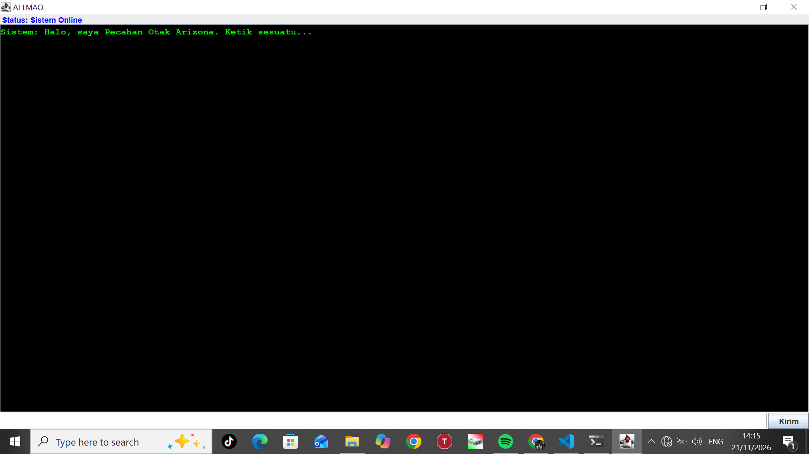
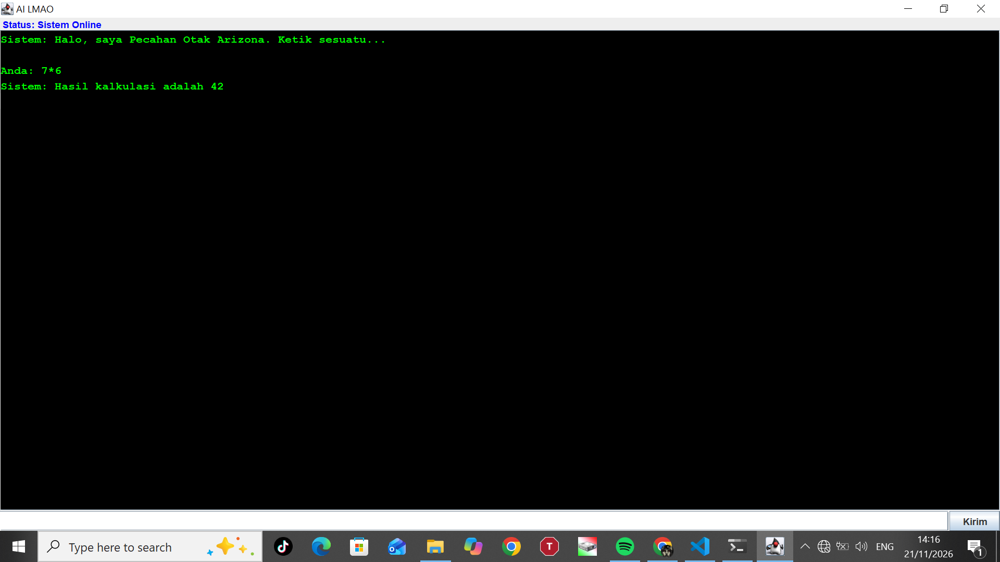
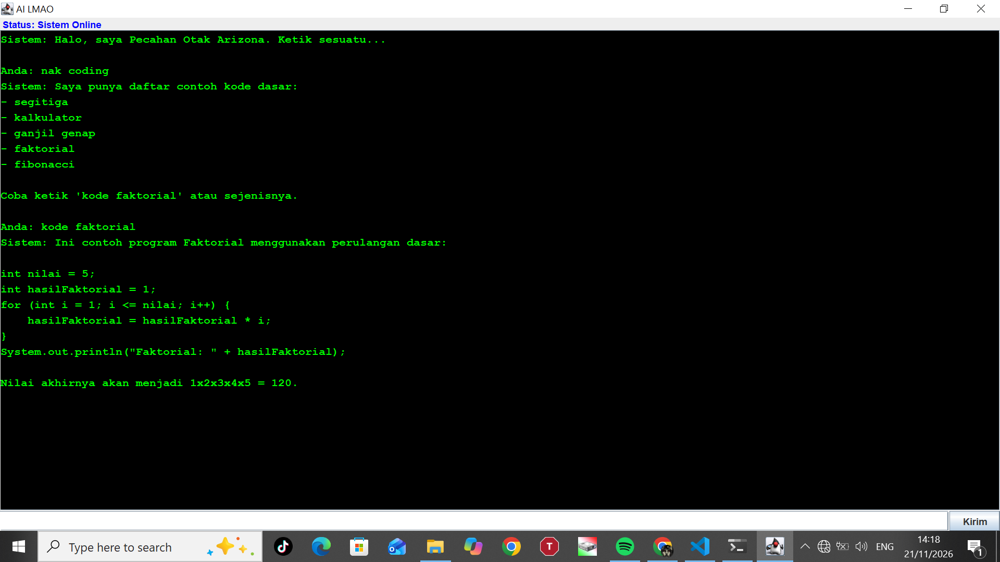

# MiniChatbot - AI LMAO (Arizona Intelligence)

MiniChatbot is an interactive desktop chatbot application built using Java Swing. It features a classic terminal-style interface (black background, green text) and operates entirely on basic Java programming logic without any external AI libraries or math parsers. 

This project was specifically designed to demonstrate the implementation of the 5 fundamental GUI Components in Java Swing.

## 5 Basic GUI Components / Parts Implementation

This application strictly implements the 5 core concepts of Java Swing components. Here is how they are mapped within the code:

1. Top-Level Container
   - Component: `JFrame`
   - Implementation: Acts as the main application window (titled "AI LMAO"). It is the base container where all other components are placed and stands alone on the screen.

2. Intermediate Container
   - Components: `JPanel`, `JScrollPane`
   - Implementation: `JPanel` (named `panelBawah`) is used to group the input text field and the send button at the bottom of the window. `JScrollPane` is used to wrap the chat area, providing scrolling functionality for long conversation histories.

3. Atomic Components
   - Components: `JLabel`, `JTextArea`, `JTextField`, `JButton`
   - Implementation: 
     - `JLabel` (`labelStatus`): Displays the static "Status: Sistem Online" text.
     - `JTextArea` (`areaChat`): The main multi-line display where the chat history is shown.
     - `JTextField` (`fieldInput`): The single-line input field where the user types their message.
     - `JButton` (`tombolKirim`): The "Kirim" (Send) button that the user interacts with.

4. Layout Manager
   - Component: `BorderLayout`
   - Implementation: Serves to set how the components are positioned. The frame uses `BorderLayout` to place the status label at the `NORTH`, the chat area at the `CENTER`, and the input panel at the `SOUTH`. The input panel also uses `BorderLayout` internally.

5. Event Handling
   - Component: `ActionListener`
   - Implementation: Handles events performed by the user. An `ActionListener` is attached to both the `JButton` (for mouse clicks) and the `JTextField` (for pressing the Enter key). When triggered, it captures the text, processes the logic, and outputs the response.

## Screenshots

### 1. Main Interface


### 2. Math Calculator in Action


### 3. Basic Coding Snippets


## Core Features

- Terminal-Style Interface: Utilizes a `JTextArea` with automatic word wrapping so long texts flow neatly downwards without horizontal scrolling.
- Automatic Math Calculator: Capable of calculating addition (+), subtraction (-), multiplication (* or x), and division (/ or :) extracted directly from natural language input.
- State-Based Recipe Assistant: Remembers the conversation state to display 7 Indonesian food recipes and waits for the user's specific choice.
- Basic Coding Assistant: Provides basic Java code snippets for beginners (Star Triangle, Calculator, Odd/Even, Factorial, and Fibonacci).
- Interactive Persona: Includes natural responses for greetings, contextual compliments to its creator (Arizona Pradifta), philosophical monologues, and sarcastic comebacks.

## How to Run

### Prerequisites
- Java Development Kit (JDK) version 8 or newer installed on your machine.

### Execution Steps
1. Save the source code as `MiniChatbot.java`.
2. Open a terminal or Command Prompt in the directory where the file is saved.
3. Compile the Java code:
   ```bash
   javac MiniChatbot.java
   ```
4. Run the program:
   ```bash
   java MiniChatbot
   ```

## Code Breakdown & Snippets

Here is a breakdown of the core logic used in the application.

### GUI Initialization & Word Wrap
The application uses Swing components styled to look like a terminal. Word wrap is enabled to prevent text from overflowing horizontally.
```java
JFrame frame = new JFrame("AI LMAO");
frame.setLayout(new BorderLayout()); 

JTextArea areaChat = new JTextArea();
areaChat.setEditable(false);
areaChat.setBackground(Color.BLACK);
areaChat.setForeground(Color.GREEN);
areaChat.setLineWrap(true);
areaChat.setWrapStyleWord(true);
```

### Event Handling & Input Normalization
The `ActionListener` captures user input, removes leading/trailing spaces, and converts it to lowercase for easier keyword matching.
```java
ActionListener kirimPesan = new ActionListener() {
    @Override
    public void actionPerformed(ActionEvent e) {
        String inputUser = fieldInput.getText();
        if(inputUser.trim().isEmpty()) return;

        String teks = inputUser.toLowerCase();
        // Logic processing follows...
    }
};
```

### Pure String Manipulation Calculator
Instead of relying on external math evaluators, the bot cleans the string of words, finds the operator, splits the string, and parses the numbers using a `try-catch` block.
```java
String teksHitung = teks.replace("berapa", "").replace("hasil", "").replace("=", "").trim();
int indeksOp = teksHitung.indexOf('+'); // Example for addition

if (indeksOp != -1) {
    try {
        double num1 = Double.parseDouble(teksHitung.substring(0, indeksOp).trim());
        double num2 = Double.parseDouble(teksHitung.substring(indeksOp + 1).trim());
        double hasilMtk = num1 + num2;
        mtkAktif = true;
    } catch (Exception ex) {
        mtkAktif = false;
    }
}
```

### State-Based Logic (Recipe Selector)
The `sedangPilihResep` boolean acts as the bot's memory. If true, it restricts the expected input to the 7 food choices.
```java
if (sedangPilihResep) {
    if (teks.contains("rujak cingur")) {
        respon = "Sistem: Resep Rujak Cingur...";
        sedangPilihResep = false; // Reset state
    }
} else if (teks.contains("aku lapar")) {
    respon = "Sistem: Berikut 7 pilihan resep...";
    sedangPilihResep = true; // Set state
}
```